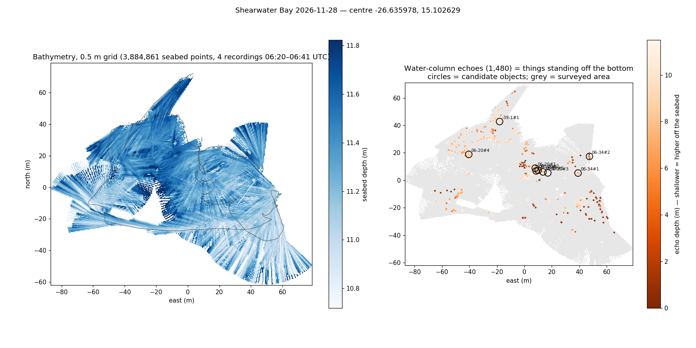

# 2026-11-28 — Shearwater Bay: data quality check

Survey centre: -26.635978, 15.102629 (about 5.6 km west of the "home" locked
on 2026-11-17, so the pipeline's own `*_preview.png` maps show the survey as a
dot; use `2026-11-28_survey_map.png` instead).

## Verdict

About 94 % of today's sonar pings have GPS and process cleanly. The only
recording without GPS (07:51, 2.6 min) is also poor sonar data and cannot be
placed on the map.

| Recording (UTC)   | Pings | GPS    | Seabed found in | Depth p5/p50/p95 (m) | Mount yaw |
|-------------------|------:|--------|----------------:|----------------------|-----------|
| 06:20:39–06:33:34 | 7,752 | full   | 97 %            | 10.64 / 11.28 / 11.84 | 165° (measured, passes agree to 0.30 m) |
| 06:34:09–06:35:59 | 1,100 | full   | 94 %            | 10.78 / 11.31 / 11.79 | 180° (measured, 0.17 m) |
| 06:39:49–06:39:53 |    42 | full   | 100 %           | 11.06 / 11.30 / 11.61 | 165° (set from 06:20) |
| 06:39:56–06:41:42 | 1,053 | full   | 100 %           | 11.00 / 11.46 / 12.00 | 165° (set from 06:20) |
| 07:51:35–07:54:14 | 1,329 | **none** | ~40 %         | unreliable            | — |

All five files decode with no checksum errors. 07:51 was cut off by the power
loss; every frame before the cut is readable.

## What failed

After the restart at ~07:49 UTC the autopilot probes every baud rate for GPS 1
and never finds it, and reports "Compass 2 not found": the external GPS/compass
module took the water. Every `/mavros/global_position/raw/fix` in black-box
session `20261128T074856Z` has status -1 at 0,0. The boat was disarmed in
E-STOP throughout that session.

## Bathymetry, nets, kelp, objects (from the GPS-covered data)

- **Bathymetry:** good. About 9,500 m² covered, flat seabed at 10.6–11.8 m.
- **Netting modules:** promising. `2026-11-28-06-20_objects.png` shows a
  horizontal layer at 7–8 m depth (≈3.5 m above the seabed) from ~530 to 700 s
  into the recording, consistent with a suspended net; 06:34 shows structures
  at 0–5 m depth.
- **Kelp / objects:** 1,480 water-column echoes (`*_water.ply`) and 9
  candidate objects (`*_objects.csv`). Each object was seen on one pass only,
  so treat them as candidates. Vertical streaks from the seabed toward the
  surface may be kelp or mooring lines.

## The 07:51 recording (no GPS)

`no_gps_07-51/` shows it as a time × across-track strip and an echogram, next
to the healthy 06:34 file for comparison. Compared with the morning files:
returns are ~15× weaker, the beam-orientation test fails (41.6° residual tilt
vs 0.6°), and depths read 2–5 m instead of 11 m. Heading survived (Pixhawk
internal compass) but speed did not (thrusters at neutral, EKF drifts without
GPS), so no track can be rebuilt. Most likely it was recorded during recovery
in shallow water. Low value; not worth more effort.

## Viewing

Open in CloudCompare (x = east, y = north, z = up, metres from the 11-17 home):
`*_seabed.ply` (seabed), `*_water.ply` (water column), `*_objects.ply`,
`*_filtered_out.ply`. `*_seabed.csv.gz` has lat, lon, depth for GIS.
Today's full `*_seabed.ply` files are included here (unlike earlier days) so
the survey can be viewed without Azure; `*_cloud.ply` stays in `boat_data/`.

## Processing notes

- Run with `scripts/process_mission.py` on the four GPS-covered files only.
  `load_gps()` does not check fix status, so including 07:51 would place it at
  0,0. Fix pending.
- The two 06:39 files had too little track overlap to measure mount yaw (the
  script fell back to 0°); they were re-run with `--mount-yaw 165`.
